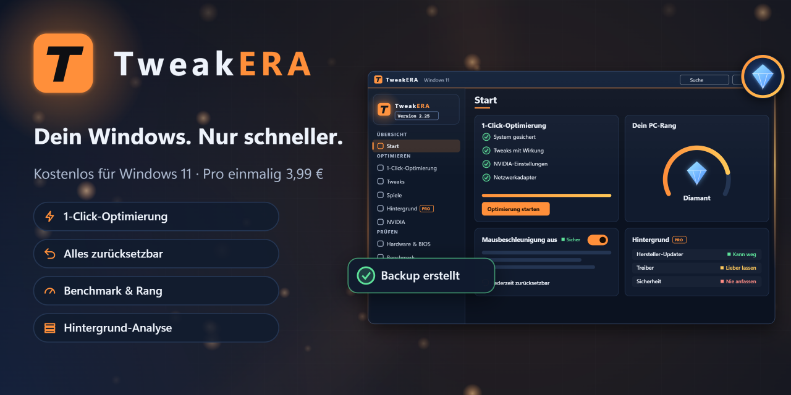

# TweakERA

Windows-11-Optimierer für Gaming und mehr Tempo. Kostenlos, jeder Schritt lässt sich zurücksetzen.

🧪 **Open Beta läuft.** Download: [neueste Version](https://github.com/Vsx-Tweaks/vsx-tweaks/releases/latest) (`TweakERA-Setup-….exe` unter „Assets“)

- 1-Click-Optimierung mit Sicherung vorher
- Über 80 Tweaks für System, Netzwerk, Audio und Spiele
- Hintergrund-Analyse, Aufräumen, Hardware-Prüfung, Benchmark mit PC-Rang
- Pro (einmalig 3,99 €): Spiel-Profile, Engpass-Finder, FPS messen, Low-End-1-Click

Nur für Windows 11. Windows warnt beim ersten Start, weil das Setup noch kein Zertifikat hat: „Weitere Informationen“ › „Trotzdem ausführen“.

💬 Discord: https://discord.gg/ZBuNXKRCag · ✉️ vsxtweaks@proton.me
